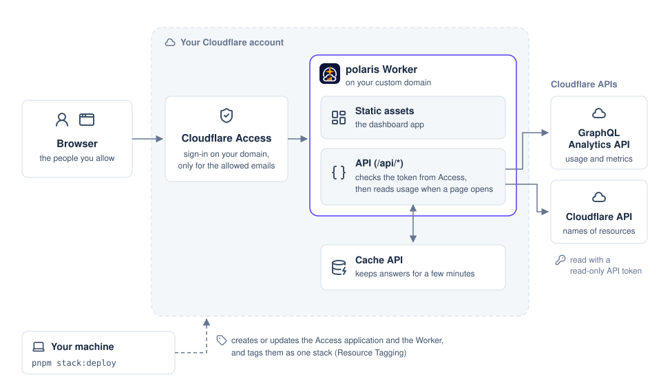

<h1 align="center">
  <picture>
    <source media="(prefers-color-scheme: dark)" srcset="images/polaris-wordmark-dark.png">
    
  </picture>
</h1>

polaris is a dashboard that shows how much of the Cloudflare Free plan your account uses: how much of each Free plan limit your usage leaves, today and in the billing cycle.
On the Free plan, it tells you when to move to Workers Paid. On Workers Paid, it tells you whether your usage would fit the Free plan again.
You deploy polaris as a single Worker in your own account without a database of its own, and Cloudflare Access protects it.

Try the [demo](https://etak64n.github.io/polaris/), which shows every page with sample data.

## Contents

- [Features](#features)
- [Architecture](#architecture)
- [Cloudflare services](#cloudflare-services)
- [Quick start](#quick-start)
- [License](#license)

## Features

polaris displays 5 sets of information about your Cloudflare account:

1. Free plan limits: polaris shows the remaining share of each Free plan limit as a gauge and the number of Workers requests stopped by a limit, on either plan.
2. Cost: polaris shows the estimated cost for the current billing cycle (the amount so far and the projected total for the cycle), plus the estimated cost on Workers Paid when you use the Free plan.
3. Product dashboards: polaris plots charts for Workers, Durable Objects, Queues, Workflows, Browser Run, D1, R2, KV, Hyperdrive, and Workers AI for a selected time range from 1 hour to 90 days, and can reload automatically.
4. D1 top queries: polaris lists the D1 queries that read or wrote the most rows.
5. Signed-in user: The bottom of the sidebar shows your email address, login method, sign-in date and time, and a log-out link.

polaris calculates the estimated cost by applying published prices to your usage, so the estimate can differ slightly from your invoice.

## Architecture



Your browser signs in through Cloudflare Access before it reaches the polaris Worker in your account.
The Worker serves the dashboard application as static assets.
On `/api/*`, the Worker verifies the Access token and reads usage and metrics from the GraphQL Analytics API and resource names from the Cloudflare API with a read-only API token.
The Worker caches the responses in the Cache API for a few minutes.

When you run `pnpm stack:deploy` on your machine, the command creates or updates the Access application and the Worker.

## Cloudflare services

polaris runs on 6 Cloudflare services:

1. Workers: Serves the dashboard application and the API on your custom domain.
2. Cloudflare Access: Lets only your allowed email addresses sign in, with the login methods that you choose in the settings.
3. GraphQL Analytics API: Provides account usage and metrics when you open a page.
4. Cloudflare API: Provides the resource names of D1, KV, Durable Objects, Queues, and Hyperdrive.
5. Cache API: Stores responses for a few minutes so that reloading a page does not query the APIs every time.
6. Resource Tagging: Tags the Access application and the Worker so that you can create and delete them as a single stack.

## Quick start

You need 4 prerequisites to deploy polaris:

1. A Cloudflare account that holds the zone for your deployment domain.
2. A Zero Trust organization in that Cloudflare account (for the Cloudflare Access team domain).
3. Node.js (`^22.23.0 || ^24.22.0 || ^26.12.0`).
4. pnpm (`pnpm@12.16.1`).

You also need `ANALYTICS_API_TOKEN`, a read-only account API token that requires `Account Analytics Read` and `D1 Read` (see `.env.example` for how to issue it).
Add `Workers KV Storage Read`, `Workers Scripts Read`, `Queues Read`, and `Hyperdrive Read` to show resource names for KV, Durable Objects, Queues, and Hyperdrive; without them, polaris shows resource IDs.

Run these 5 commands in order to configure and deploy polaris:

```bash
# Install the dependency versions recorded in pnpm-lock.yaml
pnpm install

# Create polaris.config.ts from the example and replace every value
cp polaris.config.example.ts polaris.config.ts

# Create .env from the example and write CLOUDFLARE_ACCOUNT_ID and ANALYTICS_API_TOKEN
cp .env.example .env

# Log in to the Cloudflare CLI
pnpm exec cf auth login

# Create the Cloudflare Access application and the Worker
pnpm stack:deploy
```

`polaris.config.example.ts` defines the settings of a deployment:

```typescript
// Settings of this polaris deployment.
//
// Copy this file to polaris.config.ts and replace every value. Git ignores
// polaris.config.ts. The account and the API token go in .env instead:
// see .env.example.

import { definePolarisConfig } from "./config/settings.ts";

export default definePolarisConfig({
  workerName: "polaris",
  domain: "usage.example.com",
  billing: {
    // "free" or "paid": the Workers plan of the account
    plan: "free",
    // The day of the month on which the billing cycle starts, as the invoices show it
    cycleStartDay: 1,
  },
  // Cloudflare Access, which lets only these people open polaris
  access: {
    // The team domain of your Zero Trust organization
    teamDomain: "https://example.cloudflareaccess.com",
    // The email addresses that may sign in
    allow: ["you@example.com"],
    // The login methods of your Zero Trust organization that the sign-in page offers,
    // by type, such as "onetimepin", "github", or "passkeys"
    loginMethods: ["onetimepin"],
  },
});
```

Each version of polaris is a [release](https://github.com/etak64n/polaris/releases), and its notes say what a deployment must change.
To update polaris, check out the tag of a newer release and deploy again:

```bash
# Switch to the release to deploy, such as v0.2.0
git fetch --tags
git checkout v0.2.0

# Install the dependency versions of that release, and deploy it
pnpm install
pnpm stack:deploy
```

To delete polaris from your Cloudflare account, run `pnpm stack:delete`:

```bash
# Delete the Access application and the Worker after you type the stack name to confirm
pnpm stack:delete
```

## License

polaris is licensed under the MIT License (`LICENSE`).
