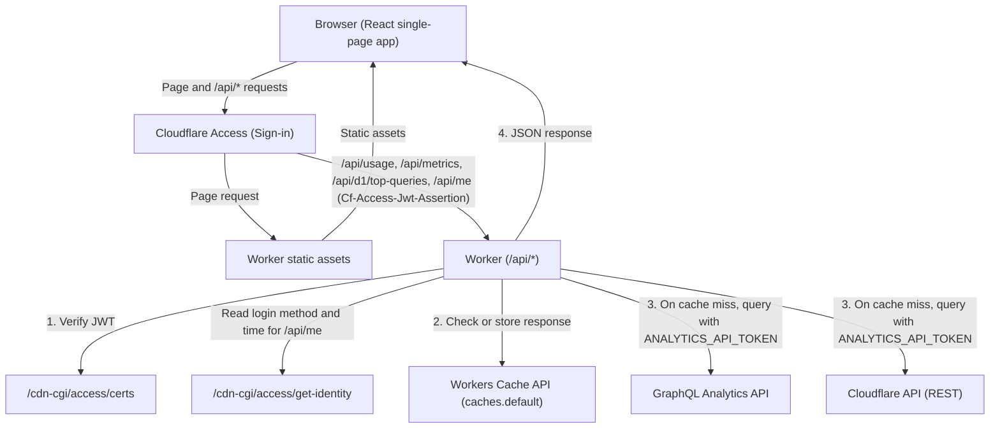
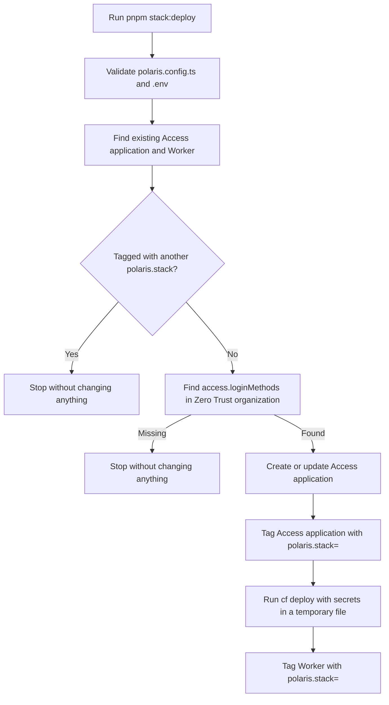

# polaris

polaris is a dashboard that shows the usage and the estimated cost of your Cloudflare account.
It runs on Cloudflare Workers, reads usage on demand from the Cloudflare GraphQL Analytics API without a database of its own, and protects access with Cloudflare Access.

## Contents

- [polaris](#polaris)
  - [How it works](#how-it-works)
    - [Request flow diagram](#request-flow-diagram)
    - [Step by step request flow](#step-by-step-request-flow)
  - [Cloudflare services](#cloudflare-services)
    - [Cloudflare Workers](#cloudflare-workers)
    - [Cloudflare Access](#cloudflare-access)
    - [GraphQL Analytics API](#graphql-analytics-api)
    - [Cloudflare API](#cloudflare-api)
    - [Cache API](#cache-api)
    - [Resource Tagging](#resource-tagging)
    - [Services polaris does not use](#services-polaris-does-not-use)
  - [Deployment](#deployment)
    - [Deployment flow](#deployment-flow)
    - [Stack deletion](#stack-deletion)
  - [Features](#features)
    - [Free plan limits](#free-plan-limits)
    - [Cost estimate](#cost-estimate)
    - [Product dashboards](#product-dashboards)
    - [D1 top queries](#d1-top-queries)
    - [Account menu](#account-menu)
  - [Quick start](#quick-start)
    - [Prerequisites](#prerequisites)
    - [Commands](#commands)
    - [Deployment settings](#deployment-settings)
    - [Environment variables](#environment-variables)
  - [License](#license)

## How it works

polaris serves a browser application from a Cloudflare Worker and reads account usage on demand when you open a page.
Every request passes through Cloudflare Access authentication, and API requests for usage, metrics, top queries, and resource names check the Workers Cache API before polaris calls the Cloudflare APIs.

### Request flow diagram

The following diagram shows how a request flows from the browser through Cloudflare Access and the Worker to the Cloudflare APIs (`worker/index.ts`, `worker/app.ts`).



### Step by step request flow

A request from the browser follows 6 steps (`worker/index.ts`, `worker/app.ts`, `worker/access.ts`, `worker/cache.ts`).

1. Sign-in at Cloudflare Access
2. Static asset delivery for the browser application
3. API calls from the browser application
4. Access JWT (JSON Web Token, a token signed by Access) verification in the Worker
5. Cache lookup in the Workers Cache API
6. Upstream queries to the GraphQL Analytics API and Cloudflare API

The details of each step are as follows:

- Sign-in at Cloudflare Access
  - The user opens the custom domain in a browser, and Cloudflare Access requires the user to sign in.
  - Access lets the request through only when the user signs in with an allowed email address and login method.
- Static asset delivery for the browser application
  - For page paths outside `/api/*`, Cloudflare serves the React single-page application from Worker static assets.
  - These requests do not run the Worker script (`cloudflare.config.ts`).
- API calls from the browser application
  - The browser application calls `/api/usage`, `/api/metrics`, `/api/d1/top-queries`, and `/api/me` to load data.
  - Cloudflare Access adds a signed JSON Web Token (JWT) in the `Cf-Access-Jwt-Assertion` header of each request that it lets through (`worker/access.ts`).
- Access JWT verification in the Worker
  - The Worker runs on `/api/*` requests and verifies the `Cf-Access-Jwt-Assertion` token with the team public keys from `<team domain>/cdn-cgi/access/certs`.
  - For `/api/me`, the Worker also calls `<team domain>/cdn-cgi/access/get-identity` to read the login method and sign-in time.
- Cache lookup in the Workers Cache API
  - For usage, metrics, and top queries, the Worker checks `caches.default` in the data center cache.
  - When a fresh response exists in the cache, the Worker returns that response immediately without calling the Cloudflare APIs.
- Upstream queries to the GraphQL Analytics API and Cloudflare API
  - When the cache has no matching entry, the Worker uses `ANALYTICS_API_TOKEN` to query the GraphQL Analytics API and the Cloudflare API.
  - The Worker stores the result in the Cache API and returns the JSON response to the browser.

## Cloudflare services

polaris uses 6 Cloudflare services and platform features to run the dashboard, protect access, read analytics, cache responses, and manage deployment resources.

1. Cloudflare Workers
2. Cloudflare Access (Zero Trust)
3. GraphQL Analytics API
4. Cloudflare API (REST)
5. Cache API
6. Resource Tagging

### Cloudflare Workers

A single Cloudflare Worker serves the browser application and runs the backend API (`cloudflare.config.ts`).
The Worker serves the React single-page application as static assets and runs the Worker code only when the request path matches `/api/*`.

`cloudflare.config.ts` configures the Worker with the following routing and runtime settings:

- Custom domain only: The Worker publishes only on the custom domain set in `domain` of `polaris.config.ts`.
- Disabled default URLs: The Worker sets `workersDev: false` and `previewUrls: false`, so it has no `workers.dev` address and no preview URL.
- Observability: The Worker enables Workers observability (`observability: { enabled: true }`).
- Asset routing: The Worker sets `notFoundHandling: "single-page-application"` and `runWorkerFirst: ["/api/*"]`.

`pnpm stack:deploy` uploads 3 secrets to the Worker (`cloudflare.config.ts`, `stack/stack.ts`):

1. `CLOUDFLARE_ACCOUNT_ID`
2. `ANALYTICS_API_TOKEN`
3. `ACCESS_AUD`

- `CLOUDFLARE_ACCOUNT_ID`: `pnpm stack:deploy` uploads this value from `.env` to the Worker as a secret, and the Worker uses this secret to know which Cloudflare account to query.
- `ANALYTICS_API_TOKEN`: `pnpm stack:deploy` uploads this value from `.env` to the Worker as a secret, and the Worker uses this secret to authenticate read-only requests to the GraphQL Analytics API and the Cloudflare API.
- `ACCESS_AUD`: `pnpm stack:deploy` sets this secret to the `AUD` (audience) tag of the Access application that it creates, and the Worker checks it when verifying the Access JWT (`worker/access.ts`).

### Cloudflare Access

Cloudflare Access (Zero Trust) protects the entire custom domain with a self-hosted Access application (`stack/stack.ts`).
The Access application has a single policy that allows only the email addresses in `access.allow`, and its sign-in page offers only the login methods in `access.loginMethods`.

The Worker interacts with Cloudflare Access in 3 ways (`worker/access.ts`, `worker/app.ts`):

1. Verifying the request JWT on every `/api/*` call
2. Reading the session identity for `/api/me`
3. Ending the session at `/cdn-cgi/access/logout`

- Verifying the request JWT on every `/api/*` call
  - Access puts a signed JWT in the `Cf-Access-Jwt-Assertion` header of every request that passes the Access policy.
  - The Worker verifies this JWT against the team public keys at `<team domain>/cdn-cgi/access/certs` and checks the `ACCESS_AUD` audience.
  - If verification fails, the Worker rejects the request and returns no usage data, which prevents exposing account usage if Access is missing or misconfigured.
- Reading the session identity for `/api/me`
  - The Worker fetches `<team domain>/cdn-cgi/access/get-identity` to read the login method and the sign-in timestamp for the account menu.
  - The Worker makes this call because the JWT contains the user's email address, but does not contain the login method.
- Ending the session at `/cdn-cgi/access/logout`
  - The `Log out` link in the account menu points to `/cdn-cgi/access/logout` to sign the user out of Cloudflare Access.

### GraphQL Analytics API

The Worker queries the Cloudflare GraphQL Analytics API at `https://api.cloudflare.com/client/v4/graphql` to read usage, product metrics, and top D1 queries (`worker/analytics.ts`, `worker/metrics.ts`).
One usage query covers at most 31 days (`MAX_QUERY_DAYS` in `worker/analytics.ts`), and `ANALYTICS_API_TOKEN` requires the `Account Analytics Read` permission to query this API.

polaris queries 18 datasets in the GraphQL Analytics API:

1. `workersInvocationsAdaptive`
2. `pagesFunctionsInvocationsAdaptiveGroups`
3. `d1AnalyticsAdaptiveGroups`
4. `d1StorageAdaptiveGroups`
5. `d1QueriesAdaptiveGroups`
6. `r2OperationsAdaptiveGroups`
7. `r2StorageAdaptiveGroups`
8. `kvOperationsAdaptiveGroups`
9. `kvStorageAdaptiveGroups`
10. `durableObjectsInvocationsAdaptiveGroups`
11. `durableObjectsPeriodicGroups`
12. `durableObjectsSqlStorageGroups`
13. `queueMessageOperationsAdaptiveGroups`
14. `queueBacklogAdaptiveGroups`
15. `workflowsAdaptiveGroups`
16. `browserRenderingBrowserTimeUsageAdaptiveGroups`
17. `hyperdriveQueriesAdaptiveGroups`
18. `aiInferenceAdaptiveGroups`

### Cloudflare API

The Worker calls the Cloudflare REST API at `https://api.cloudflare.com/client/v4` to read the names of resources (`NAMES_API` and `databaseNames` in `worker/analytics.ts`).
Analytics datasets report several products by resource ID rather than by resource name, so the Worker looks up their names through the REST API.

The Worker reads resource names for 5 products, using the following permissions on `ANALYTICS_API_TOKEN` (`.env.example`, `worker/analytics.ts`):

1. D1 databases
2. KV namespaces
3. Durable Objects namespaces
4. Queues
5. Hyperdrive configurations

- D1 databases: Requires `D1 Read` (required for polaris).
- KV namespaces: Requires `Workers KV Storage Read` (optional).
- Durable Objects namespaces: Requires `Workers Scripts Read` (optional).
- Queues: Requires `Queues Read` (optional).
- Hyperdrive configurations: Requires `Hyperdrive Read` (optional).

If `ANALYTICS_API_TOKEN` does not have the read permission for KV, Durable Objects, Queues, or Hyperdrive, the Worker cannot read those names.
In that case, the dashboard for that product displays the resource IDs instead of the resource names.

### Cache API

The Worker uses the Workers runtime Cache API (`caches.default`) to keep API responses in the data center cache (`worker/cache.ts`, `worker/app.ts`).
Caching prevents page reloads from querying the GraphQL Analytics API and the Cloudflare API on every request.

The Worker caches 3 kinds of data with different lifetimes (`USAGE_CACHE_SECONDS`, `NAMES_CACHE_SECONDS`, and `refreshSeconds` in `worker/app.ts` and `shared/metrics.ts`):

1. Account usage and D1 top queries: Cached for 5 minutes (`300` seconds).
2. Resource names: Cached for 1 hour (`3600` seconds).
3. Product metrics: Cached for 1 minute (`60` seconds) when the selected range uses 1-minute periods (`1h`, `3h`), and for 5 minutes (`300` seconds) for all other ranges.

### Resource Tagging

`pnpm stack:deploy` uses Cloudflare Resource Tagging to attach the tag `polaris.stack=<Worker name>` to the Access application and the Worker (`stack/stack.ts`).
`pnpm stack:delete` searches for resources with this tag to delete them.

Resource Tagging provides 2 operational safeguards for deployments:

1. Stateless deployment machine: Because Cloudflare stores the tags on the resources, the machine running `pnpm stack:deploy` keeps no local state file.
2. Stack isolation: If an existing Access application or Worker carries a `polaris.stack` tag with a different stack name, `pnpm stack:deploy` refuses to use or overwrite that resource.

### Services polaris does not use

polaris does not use D1, R2, KV, or Durable Objects for its own storage (`cloudflare.config.ts` defines no storage bindings).
polaris has no database or storage of its own, and it keeps usage and resource names only in the Cache API for a few minutes to 1 hour.

## Deployment

`pnpm stack:deploy` provisions and updates the Cloudflare Access application and the Worker as a single stack (`stack/stack.ts`).
`pnpm stack:delete` removes the tagged resources and their tags (`stack/cli.ts`, `stack/stack.ts`).

### Deployment flow

The following diagram shows the order of operations when you run `pnpm stack:deploy` (`stack/stack.ts`).



`pnpm stack:deploy` runs 6 steps in order (`deployStack` in `stack/stack.ts`):

1. Validate `polaris.config.ts` and `.env`
2. Check existing resources and their `polaris.stack` tags
3. Verify `access.loginMethods` in the Zero Trust organization
4. Create or update the Access application and tag it
5. Deploy the Worker with `cf deploy` and temporary secrets
6. Tag the Worker

- Validate `polaris.config.ts` and `.env`
  - The CLI validates all settings in `polaris.config.ts` and checks `CLOUDFLARE_ACCOUNT_ID` and `ANALYTICS_API_TOKEN` in `.env`.
- Check existing resources and their `polaris.stack` tags
  - The CLI checks whether the Access application for `domain` or the Worker for `workerName` already exists.
  - If an existing resource has a `polaris.stack` tag from another stack, the CLI stops before changing anything.
- Verify `access.loginMethods` in the Zero Trust organization
  - The CLI searches the Zero Trust organization for the login methods listed in `access.loginMethods`.
  - If any configured login method does not exist in the organization, the CLI stops before changing anything.
- Create or update the Access application and tag it
  - The CLI creates or updates the self-hosted Access application first and attaches the `polaris.stack=<Worker name>` tag.
  - Creating the Access application before deploying the Worker ensures that the custom domain is never publicly exposed without Cloudflare Access.
- Deploy the Worker with `cf deploy` and temporary secrets
  - The CLI writes `CLOUDFLARE_ACCOUNT_ID`, `ANALYTICS_API_TOKEN`, and the Access application's `ACCESS_AUD` to a temporary file.
  - The CLI runs `cf deploy` with that file and deletes the temporary file immediately afterward.
- Tag the Worker
  - The CLI attaches the `polaris.stack=<Worker name>` tag to the deployed Worker.

### Stack deletion

`pnpm stack:delete` removes a deployed stack in 4 steps (`stack/cli.ts`, `stack/stack.ts`):

1. List tagged resources
2. Confirm the stack name
3. Delete the Worker and the Access application in order
4. Delete the resource tags

- List tagged resources: The CLI queries Resource Tagging for all resources carrying `polaris.stack=<Worker name>` and prints the list.
- Confirm the stack name: The CLI asks you to type the stack name to confirm deletion, or accepts `--confirm <stack name>` in environments where nobody can type.
- Delete the Worker and the Access application in order: The CLI deletes the Worker first and the Access application second, so the domain stops serving before Access protection is removed.
- Delete the resource tags: The CLI deletes the `polaris.stack` tags for each removed resource.

## Features

The polaris interface provides 5 feature areas across the `Overview` page, the product pages, and the sidebar.

1. Free plan limits
2. Cost estimate
3. Product dashboards
4. D1 top queries
5. Account menu

### Free plan limits

The `Free plan limits` section on the `Overview` page appears only when `billing.plan` in `polaris.config.ts` is `"free"` (`src/components/FreeLimits.tsx`).
At the top, it shows the count of Workers requests stopped by a limit during the last 31 days.

Below that count, polaris displays 3 tables of limits, each sorted with the least remaining share first:

1. `Per day`
2. `Size and count`
3. `Per month`

- `Per day`: Daily limits that reset at 00:00 UTC, showing the free limit, the amount used today, and `Left`.
- `Size and count`: Size and count limits, showing the free limit, the current amount (`Now`), and `Left`.
- `Per month`: Monthly free tier amounts for R2, showing the free amount, the projected usage for the cycle, and `Left`.

Every row shows `Left` as a gauge and a percentage of the remaining allowance.
When the remaining allowance falls below 20%, the gauge turns amber; when usage reaches the limit, the gauge empties and the percentage turns red.

### Cost estimate

The `Cost` section on the `Overview` page shows the estimated bill for the current billing cycle (`src/components/CostSummary.tsx`).
The start day of the billing cycle comes from `billing.cycleStartDay` in `polaris.config.ts`.

The summary displays up to 3 headline totals above a per-item breakdown table:

1. `This cycle so far`
2. `Projected`
3. `On Workers Paid`

- `This cycle so far`: The estimated cost of usage from the start of the current billing cycle through today.
- `Projected`: The estimated cost at the end of the current billing cycle.
- `On Workers Paid`: Shown only when `billing.plan` is `"free"`, indicating what the current usage would cost on the Workers Paid plan.

Below the totals, a breakdown table lists each priced item of Workers, D1, and R2 with its `Used`, `Included`, `Cost`, and `Projected` values.

- Price source: polaris applies the published prices in `shared/pricing.ts` (checked on `2026-11-05` in `PRICES_CHECKED_ON`) to the usage from analytics.
- Invoice difference: Because Cloudflare analytics sample some datasets, the estimated cost can differ slightly from the invoice (`shared/cost.ts`).

### Product dashboards

The sidebar organizes 10 product dashboards into 3 groups (`src/components/Shell.tsx`):

1. `Compute`
2. `Storage & databases`
3. `AI`

- `Compute`: `Workers`, `Durable Objects`, `Queues`, `Workflows`, and `Browser Run`.
- `Storage & databases`: `D1`, `R2`, `KV`, and `Hyperdrive`.
- `AI`: `Workers AI`.

Each product dashboard provides time-series charts for the product's metrics and a table of totals per resource (`shared/metrics.ts`, `src/components/FilterPill.tsx`):

- Time range selection: You can choose `1h`, `3h`, `12h`, `1d`, `3d`, `1w`, `30d`, or `90d` (`METRIC_RANGES` in `shared/metrics.ts`).
- Resource filtering: You can pick specific resources to filter the charts.
- Auto refresh: Turning on `Auto refresh` reloads the dashboard every 60 seconds for 1-minute period ranges (`1h` and `3h`), and every 300 seconds for all other ranges (`refreshSeconds` in `shared/metrics.ts`, `AutoRefreshPill` in `src/components/FilterPill.tsx`).

### D1 top queries

The `D1` dashboard includes a `Top queries` section (`TOP_QUERY_COUNT`, `TOP_QUERY_DAYS`, and `readOrder` in `worker/app.ts`).
It lists the top 20 queries over the last 1 day or 7 days, ordered by either the most rows read (`rowsRead`) or the most rows written (`rowsWritten`).

### Account menu

The bottom of the sidebar displays a button with the signed-in user's email address (`src/components/AccountMenu.tsx`).
Selecting this button opens a menu with 4 items:

1. The signed-in email address
2. `Login method` (such as `Passkey` or `One-time PIN`)
3. `Signed in` (the date and time when the user signed in)
4. `Log out`

## Quick start

Follow the steps below to configure, deploy, and delete polaris in your Cloudflare account.

### Prerequisites

You need 4 things before deploying polaris (`package.json`):

1. A Cloudflare account that holds the zone for your target custom domain
2. A Zero Trust organization on that Cloudflare account (for the Cloudflare Access team domain)
3. Node.js matching `^22.23.0`, `^24.22.0`, or `^26.12.0` (`engines` in `package.json`)
4. `pnpm@12.16.1` (`packageManager` in `package.json`)

### Commands

Run the following 5 commands in order to install dependencies, configure your deployment, authenticate the Cloudflare CLI (`cf`, included in `devDependencies`), and deploy the stack:

```bash
# Install the exact dependency versions recorded in pnpm-lock.yaml (--frozen-lockfile stops without updating the lockfile if it does not match package.json)
pnpm install --frozen-lockfile

# Create your deployment settings file (replace every value in polaris.config.ts; Git ignores it)
cp polaris.config.example.ts polaris.config.ts

# Create your environment file (fill in CLOUDFLARE_ACCOUNT_ID and ANALYTICS_API_TOKEN; Git ignores it)
cp .env.example .env

# Sign in to the Cloudflare CLI (cf is installed in devDependencies)
pnpm exec cf auth login

# Deploy the Access application and the Worker to your Cloudflare account
pnpm stack:deploy
```

To delete the deployed Worker and Access application from your Cloudflare account, run `pnpm stack:delete`:

```bash
# List the tagged stack resources, prompt for the stack name, and delete them
pnpm stack:delete

# Delete the stack without an interactive prompt in environments where nobody can type (--confirm <stack name> confirms the stack name)
pnpm stack:delete --confirm polaris
```

### Deployment settings

Copy `polaris.config.example.ts` to `polaris.config.ts` and replace every value with your own settings.
`polaris.config.example.ts` contains the following configuration structure:

```typescript
// Settings of this polaris deployment.
//
// Copy this file to polaris.config.ts and replace every value. Git ignores
// polaris.config.ts. The account and the API token go in .env instead:
// see .env.example.

import { definePolarisConfig } from "./config/settings.ts";

export default definePolarisConfig({
  workerName: "polaris",
  domain: "usage.example.com",
  billing: {
    // "free" or "paid": the Workers plan of the account
    plan: "free",
    // The day of the month on which the billing cycle starts, as the invoices show it
    cycleStartDay: 1,
  },
  // Cloudflare Access, which lets only these people open polaris
  access: {
    // The team domain of your Zero Trust organization
    teamDomain: "https://example.cloudflareaccess.com",
    // The email addresses that may sign in
    allow: ["you@example.com"],
    // The login methods of your Zero Trust organization that the sign-in page offers,
    // by type, such as "onetimepin", "github", or "passkeys"
    loginMethods: ["onetimepin"],
  },
});
```

### Environment variables

Copy `.env.example` to `.env` and set the 2 required values:

1. `CLOUDFLARE_ACCOUNT_ID`
2. `ANALYTICS_API_TOKEN`

- `CLOUDFLARE_ACCOUNT_ID`: The ID of the Cloudflare account that polaris watches and where `cf` deploys the Worker. The custom domain in `polaris.config.ts` must belong to this account.
- `ANALYTICS_API_TOKEN`: A read-only Cloudflare account API token that reads usage for `CLOUDFLARE_ACCOUNT_ID`.
  - Required permissions: `Account Analytics Read` and `D1 Read`.
  - Optional permissions for resource names: `Workers KV Storage Read`, `Workers Scripts Read`, `Queues Read`, and `Hyperdrive Read` (without these, those dashboards show resource IDs instead of names).

Read `.env.example` for the step-by-step instructions and the pre-filled link to issue `ANALYTICS_API_TOKEN`.

## License

polaris is licensed under the MIT License (`LICENSE`).
